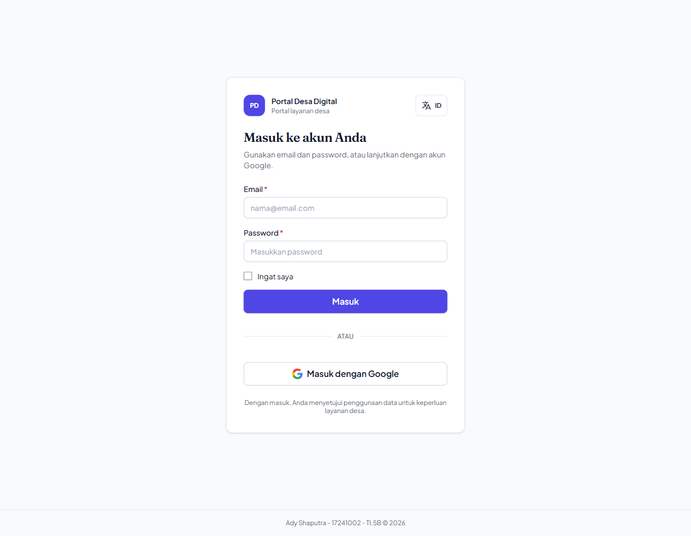
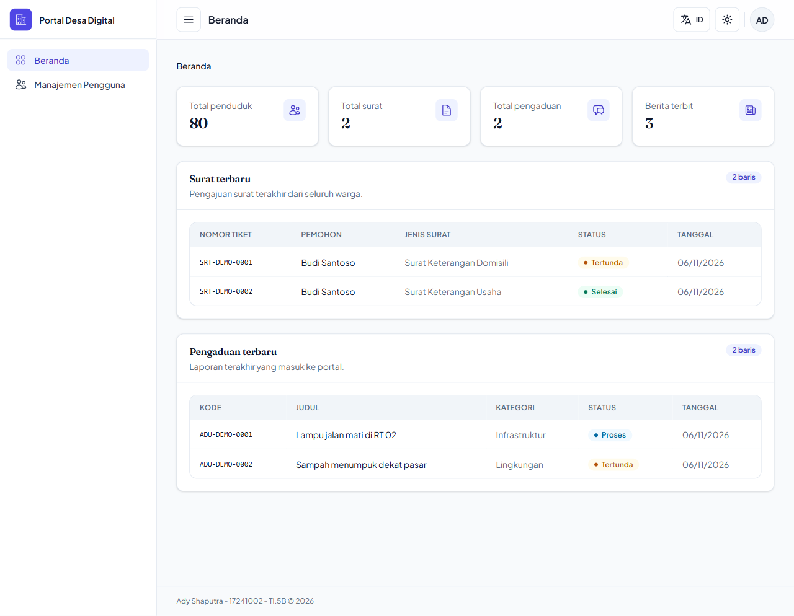
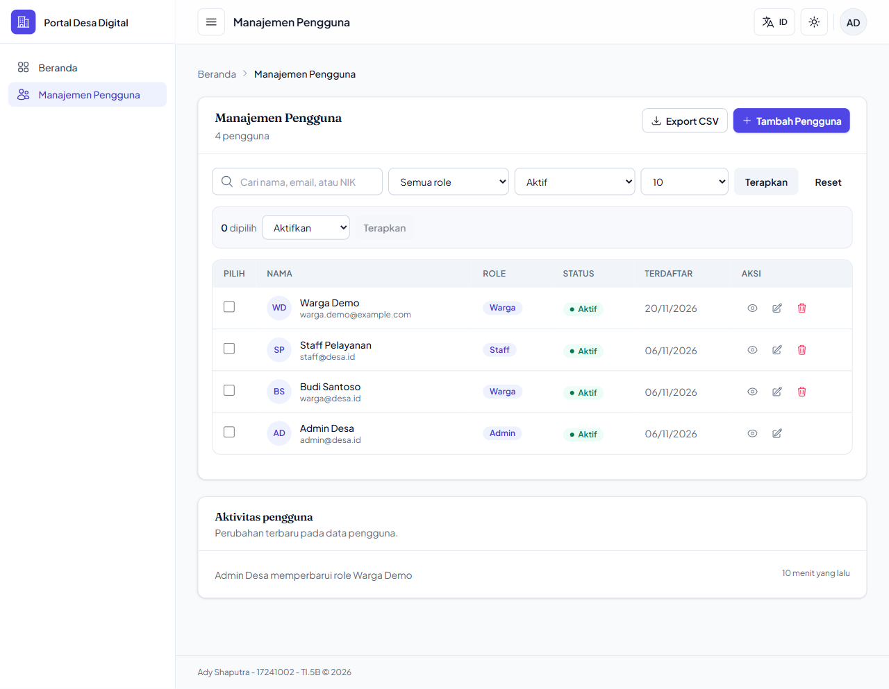
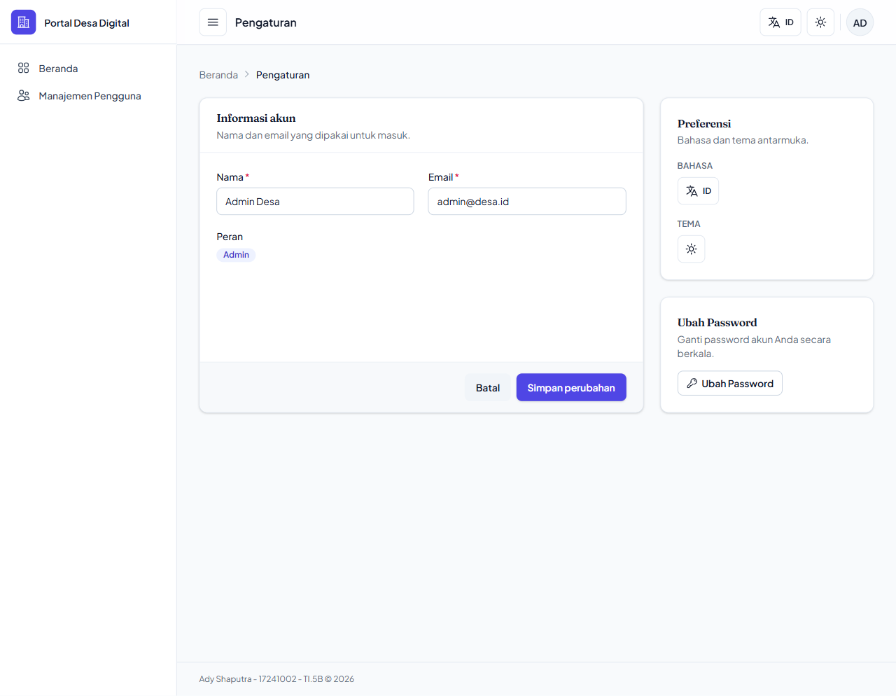
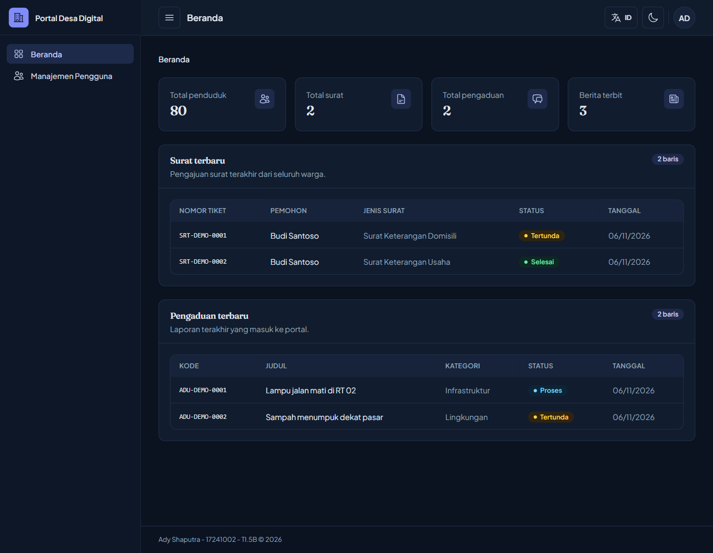

# Portal Desa Digital

Portal Desa Digital adalah aplikasi web untuk pengelolaan informasi dan layanan desa.
Project ini dikembangkan sebagai bagian dari mata kuliah **Pemrograman Web** dan
dibangun secara bertahap dari minggu ke minggu.

## Informasi Mahasiswa

| Keterangan | Data |
|---|---|
| Nama | Ady Shaputra |
| NIM | 17241002 |
| Kelas | TI.5B |
| Program Studi | Teknik Informatika |
| Fakultas | Teknologi Informasi |
| Universitas | Adhirajasa Reswara Sanjaya |

## Technology Stack

| Komponen | Teknologi |
|---|---|
| Backend | Laravel 13 |
| PHP | PHP 8.4 (Docker) |
| Database | MySQL 8.4 |
| Web Server | Laravel Sail |
| Container | Docker |
| Template | Blade |
| CSS Framework | Tailwind CSS 4 |
| JavaScript | Alpine.js 3 |
| Font | Plus Jakarta Sans dan Fraunces (Fontsource) |
| Ikon | Heroicons (Blade UI Kit) |
| Build Tool | Vite |
| Package Manager | Composer dan NPM |

## Tampilan Aplikasi

### Login



### Dashboard Admin



### Manajemen Pengguna



### Pengaturan



### Mode Gelap



> Screenshot menggunakan data demo.

## Persyaratan

- Docker (Docker Compose v2)
- Git
- Browser modern

PHP, Composer, dan Node.js **tidak perlu** dipasang di Windows. Semua perintah
Composer, Artisan, dan PHP dijalankan di dalam container melalui Laravel Sail.

## Menjalankan Docker

Jalankan dari folder project `website-desa`:

```powershell
docker compose up -d
```

Perintah tersebut menjalankan container aplikasi dari image Sail `sail-8.4/app`
(PHP 8.4) serta MySQL 8.4. Jika image belum tersedia, Docker akan membangunnya
dari `vendor/laravel/sail/runtimes/8.4`.

Cek status container:

```powershell
docker compose ps
```

Dependency `vendor` dan `node_modules` disimpan di named volume Docker agar performa
lebih baik di Windows. Saat pertama kali menjalankan project atau setelah mengubah
`composer.json`/`package.json`, jalankan:

```powershell
docker compose run --rm --no-deps laravel.test composer install
docker compose run --rm --no-deps laravel.test npm ci
```

Setelah container berjalan, aplikasi dapat diakses di:

| Layanan | Alamat |
|---|---|
| Aplikasi Laravel | http://localhost:8081 |
| Vite dev server | http://localhost:5173 |
| MySQL dari host | 127.0.0.1:3307 |

## Menghentikan Docker

```powershell
docker compose down
```